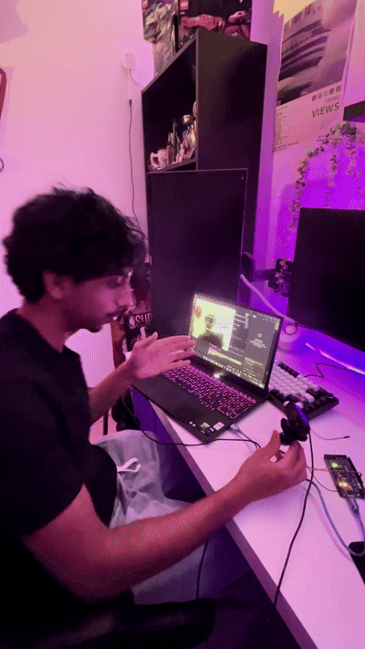
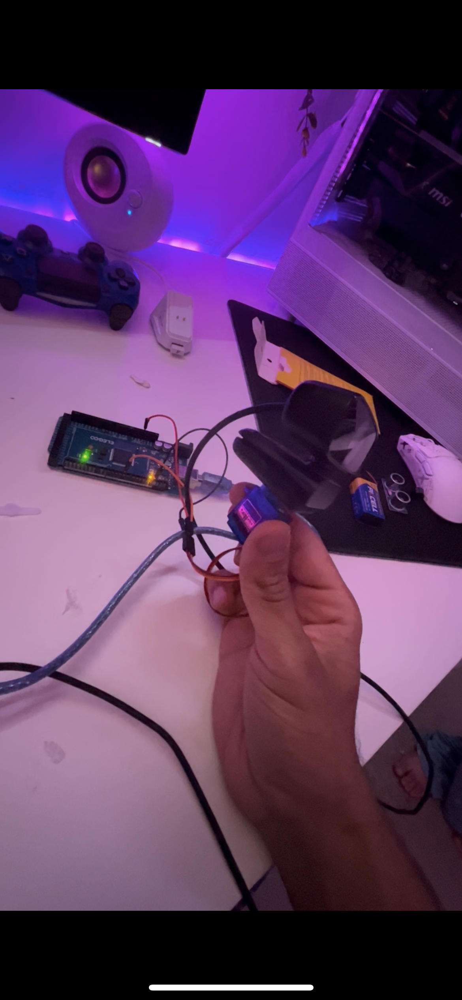

# OpenCV Face-Tracking Sentry Turret

 


## Overview
A single-axis face-tracking sentry turret driven by proportional control. The system uses a USB webcam and OpenCV's Haar Cascades to detect a face, calculates the pixel offset from the center of the frame, and sends serial commands to an Arduino Mega to actuate a pan servo. 

## Hardware Stack
*   **Microcontroller:** Arduino Mega 2560
*   **Vision:** Standard USB Webcam
*   **Actuation:** Standard 5V Servo Motor
*   **Mounting:** Webcam fixed to the servo horn (3D-printed bracket in progress)

## Software Dependencies
*   Python 3.x
*   `opencv-python`
*   `pyserial`
*   `numpy`

## Control Logic
The tracking utilizes a proportional control loop (Kp = 0.035). The Python script calculates the horizontal error (`error_x`) between the target face center and the camera frame center. To prevent mechanical jitter and micro-stutters, a 15-pixel deadzone is implemented. If the target leaves the deadzone, the script calculates a new pan angle clamped between 10° and 170° and writes the coordinate to the Arduino over Serial.

## Installation & Setup

1. **Wire the Hardware:** 
   * Connect the servo signal pin to the Arduino Mega. Provide external 5V power to the servo to avoid burning out the Mega's voltage regulator.
 

2. **Flash the Arduino:**
   * Upload [`turret_listener/turret_listener.ino`](turret_listener/turret_listener.ino) to the Arduino Mega. It listens at `9600` baud for angles prefixed by `P` (for example `P90`) and writes them to the servo on pin 6.
   * Close the Arduino IDE Serial Monitor afterwards, or Python can't open the port.

3. **Install Python Libraries:**
   ```bash
   pip install "opencv-python<5" pyserial numpy
   ```

4. **Run the Tracker:**
   * Set the serial port (`COM3`) and camera index (`cv2.VideoCapture(1)`) in `sentry_turret.py` to match your setup.
   ```bash
   python sentry_turret.py
   ```
   * Press `q` to quit.

## Tuning Notes

* Kp = 0.05 overshot and oscillated; Kp = 0.02 was stable but sluggish. 0.035 with a 15-pixel deadzone tracks smoothly.
* If the turret turns away from you, flip the sign on the angle update (`+=` vs `-=`). It depends on how the servo is mounted.
* OpenCV 5 moved the Haar cascade API; install OpenCV 4 with `pip install "opencv-python<5"`.
